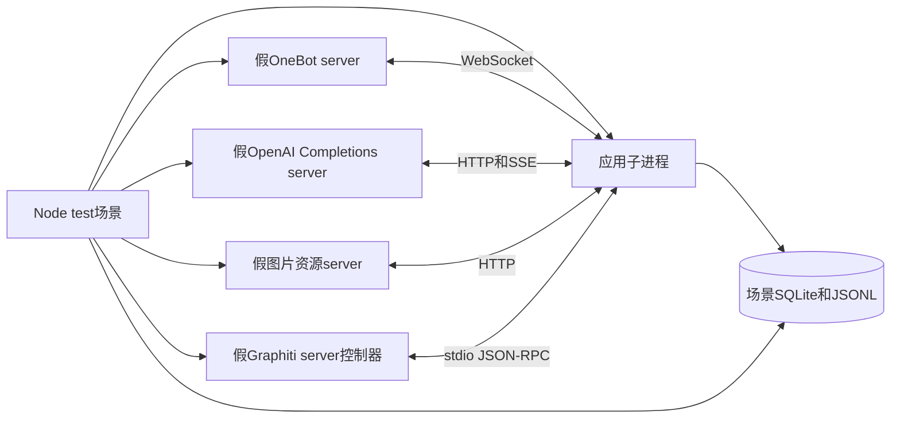

# 消息回复调度测试系统设计

## 测试目标

测试系统覆盖消息从OneBot事件进入到回复发送的完整过程，重点验证：

- 同群消息按真实到达顺序写入数据库。
- @合并窗口、闲时触发和Croner定时任务。
- 每群回复FIFO及跨群并行。
- 回复生成期间到达新消息时的水位线和乱序提示。
- 工具循环、深度研究回合链、模型回退和reminder。
- 图片描述队列的并发、去重、超时和等待者通知。
- Graphiti检索、合并episode和异步写入。
- 进程重启后的会话与触发边界恢复。

测试只替换外部服务，项目内部组件全部运行真实代码：

- OneBot WebSocket客户端及消息转换。
- SQLite数据库和Drizzle迁移。
- `GroupReplyManager`和`ScheduledTaskManager`。
- `ReplyAgent`、pi-ai、pi-agent-core及后续升级后的AgentSession。
- `DescQueue`和图片预处理。
- `GraphitiClient`的stdio JSON-RPC通信。
- Croner及真实定时器。

## 进程组织

每个测试场景使用独立的应用子进程和工作目录。测试父进程负责启动假服务、发送OneBot事件、控制模型响应闸门、检查数据库和断言结果。



进程职责：

- 测试父进程
  - 使用`node:test`组织场景。
  - 在`127.0.0.1`随机空闲端口启动HTTP和WebSocket服务。
  - 通过IPC启动和停止应用子进程。
  - 使用事件、请求记录和只读数据库连接进行断言。
- 应用子进程
  - 在独立场景目录中运行，所有相对数据文件都写入该目录。
  - 使用测试配置和真实SQLite。
  - 启动真实的bot、回复管理器、定时任务、描述队列和GraphitiClient。
- 假Graphiti server
  - 由`GraphitiClient`通过现有`uv run python ...`方式启动。
  - 通过场景目录中的控制文件和记录文件与测试父进程交换状态。

应用子进程通过`node --import tsx`运行，父进程使用带IPC的`fork()`。测试运行不需要外部QQ、模型服务、Neo4j或Graphiti服务。

## 应用组合入口

当前`src/index.ts`同时承担配置读取、服务组装和进程生命周期管理。测试需要提取可重复使用的应用组合入口：

```ts
export interface ApplicationOptions {
    config: AppConfig;
    models: Models;
    graphitiServerPath?: string;
    enableWebPanel?: boolean;
}

export interface Application {
    start(): Promise<void>;
    ready(): Promise<void>;
    stop(): Promise<void>;
}
```

`src/app.ts`负责创建应用，`src/index.ts`只负责读取生产配置并调用该入口。

组合入口需要满足：

- 通过参数接收`AppConfig`和`Models`，测试不得导入生产`config.ts`。
- `DescQueue`通过构造函数接收`AppConfig`和`Models`，不直接读取生产配置。
- `enableWebPanel: false`时不启动Astro服务。
- `graphitiServerPath`允许测试指定假Graphiti server文件。
- `ready()`在登录信息处理、白名单群管理器预初始化和定时任务启动完成后返回。
- `stop()`先停止定时任务，再等待回复会话与 Agent 结束（让进行中的回复先完成再断开连接），随后释放 OneBot 连接、停止 Web 服务、等待消息入库、停止描述队列、关闭 session、关闭 GraphitiClient，最后关闭 SQLite。
- `stop()`清理`globalThis`上的应用引用，避免同一进程中的后续实例读取旧状态。
- 描述队列提供等待全部工作结束的方法，关闭时先等待进行中的请求完成或中止。
- 图片描述超时和abort等待时间成为`DescQueue`构造参数，生产默认值保持不变，测试可以使用较短的超时时间。

测试子进程在动态导入`src/app.ts`之前进入场景工作目录，确保图片、日志、harness和调试文件都位于场景目录。

## 测试目录

```text
test/integration/
  app/
    child.ts
    create-test-config.ts
  fakes/
    onebot-server.ts
    openai-completions-server.ts
    asset-server.ts
    graphiti_server.py
  runner/
    scenario.ts
    scenario-runner.ts
    wait-for.ts
    database-inspector.ts
    artifacts.ts
    messages.ts
  scenarios/
    ingress-order.test.ts
    at-merge.test.ts
    silence.test.ts
    queue-fifo.test.ts
    watermark.test.ts
    scheduled.test.ts
    tools-research.test.ts
    failures.test.ts
    graphiti.test.ts
    desc-queue.test.ts
    restart.test.ts
```

场景产物保存到：

```text
data/test-runs/<scenario>-<uuid>/
  config.json
  app.log
  app.out.log
  onebot-events.jsonl
  openai-requests.jsonl
  graphiti-calls.jsonl
  messages.db
  data/
```

`data/`已经由gitignore覆盖。成功的场景可以删除临时产物，失败的场景保留全部产物用于诊断。

## 假OneBot server

### 协议范围

假OneBot server使用现有`ws`依赖提供WebSocket服务，支持当前应用使用的`mode: 'ws'`。

连接建立后发送：

```json
{
  "post_type": "meta_event",
  "meta_event_type": "lifecycle",
  "sub_type": "connect",
  "self_id": 10000,
  "time": 1700000000
}
```

支持以下API action：

- `get_login_info`
- `get_group_member_info`
- `send_group_msg`
- `get_msg`
- `get_forward_msg`

API响应包含原始`echo`，成功响应采用：

```json
{
  "status": "ok",
  "retcode": 0,
  "data": {},
  "echo": "原始echo"
}
```

失败响应可以配置`status`、`retcode`和`message`。

### 事件构造

提供`emitGroupMessage()`，接收完整的消息数组和发送者信息，生成真实OneBot群消息事件。消息数组可以包含：

- `text`
- `at`
- `image`
- `reply`
- `forward`

每个事件使用单调递增的OneBot `message_id`。发送时间由场景显式给出，避免依赖系统时间构造预期文本。

### 发送记录和控制

`send_group_msg`需要：

- 按收到请求的顺序分配回复`message_id`。
- 记录群号、消息数组、请求时间和分配结果。
- 支持按场景配置返回失败。
- 支持响应闸门，让测试暂停某个回复API响应。
- 在闸门等待期间记录请求已经到达，使测试可以检查回复写入数据库和后续调度的顺序。

`get_msg`和`get_forward_msg`返回场景注册的嵌套消息，并支持独立的延迟和失败配置。

## 假OpenAI Completions server

### HTTP和SSE

假OpenAI Completions server提供：

```text
POST /v1/chat/completions
```

同时支持：

- `stream: true`：返回`text/event-stream`，发送OpenAI Chat Completions chunk和`data: [DONE]`。
- `stream: false`：返回普通JSON，用于记忆关键词生成和其他非流式调用。

流式工具调用使用标准字段：

```json
{
  "choices": [
    {
      "index": 0,
      "delta": {
        "role": "assistant",
        "tool_calls": [
          {
            "index": 0,
            "id": "call_reply_1",
            "type": "function",
            "function": {
              "name": "reply",
              "arguments": "{\"messages\":[],\"requires_deep_research\":false}"
            }
          }
        ]
      },
      "finish_reason": "tool_calls"
    }
  ]
}
```

每个响应可以包含`usage`，用于检查usage读取和调试导出。

### 场景响应序列

响应按channel组织。channel可以由模型ID和请求中的场景标记组成，例如`primary/group-a`。每个channel拥有独立队列，保证跨群并行场景不会互相消耗响应。

一条响应规则包含：

```ts
interface ModelResponseRule {
    match?: {
        model?: string;
        channel?: string;
        requestIncludes?: string;
    };
    action:
        | {type: 'replyTool'; params: ReplyToolParams}
        | {type: 'toolCall'; name: string; arguments: unknown}
        | {type: 'text'; text: string}
        | {type: 'json'; value: unknown}
        | {type: 'httpError'; status: number; body: unknown}
        | {type: 'streamError'; message: string}
        | {type: 'hang'};
    gate?: string;
    delayMs?: number;
}
```

`replyTool`和`toolCall`由假服务负责序列化`arguments`。场景代码只声明参数对象。

### 闸门

每个具名闸门有两个事件：

- `started`：请求已经到达并记录，响应尚未发送。
- `release`：测试允许响应继续。

例如：

```ts
await openAI.waitForGate('group-a-first-reply');
await oneBot.emitGroupMessage(messageB);
await openAI.releaseGate('group-a-first-reply');
```

测试通过闸门构造确定的并发时序，不依赖猜测模型请求何时到达。

### 请求记录

每次请求记录：

- 序号和channel。
- 请求JSON。
- `model`、`stream`和`sessionId`相关字段。
- 当前channel和全局活跃请求数。
- 响应规则序号。
- SSE开始、结束、客户端断开和错误。
- 闸门等待及释放时间。

出现没有匹配规则的请求时，服务返回明确的400错误并记录协议违例。场景结束时断言：

- 没有未处理的协议违例。
- 所有应当消耗的响应规则均已消耗。
- 所有请求均已结束。
- 活跃请求计数恢复为零。

## 假Graphiti server

### 启动和协议

假Graphiti server使用Python标准库编写，由真实`GraphitiClient`通过现有命令启动：

```bash
uv run python test/integration/fakes/graphiti_server.py
```

它从stdin逐行读取JSON-RPC请求，并向stdout逐行返回JSON-RPC响应。支持：

- `initialize`
- `search`
- `search_nodes`
- `add_episode`
- `shutdown`

未知方法返回JSON-RPC method-not-found错误。

### 行为配置

启动环境变量包含场景配置文件和记录文件的位置。配置文件定义：

- `search`返回的事实、时间和数量。
- `search_nodes`返回的实体及摘要。
- 指定方法返回RPC错误。
- `add_episode`的延迟或具名闸门。
- episode UUID分配规则。

每次调用记录：

- JSON-RPC id和方法。
- 群号和查询参数。
- episode名称、内容、来源和参考时间。
- 调用开始和结束顺序。

需要暂停调用时，假服务写入`<gate>.started`文件并等待`<gate>.release`文件出现。测试父进程通过写文件释放闸门，不增加新的生产通信接口。

`shutdown`返回成功后以状态码0退出。

## 同步和断言

### 事件等待

`waitFor()`同时支持：

- 假服务事件订阅。
- 数据库条件检查。
- 场景记录文件条件检查。
- 明确的超时时间。

所有等待都必须在条件满足时立即结束。禁止使用固定长时间等待代替状态检查。

需要验证“某事没有发生”的场景使用有界观察窗口，并同时断言：

- 指定事件计数没有变化。
- 没有新增模型请求。
- 没有新增OneBot回复。
- 数据库没有新增目标记录。

### 数据库检查

测试父进程使用`better-sqlite3`只读连接检查场景SQLite，验证：

- `messages.id`和`message_id`顺序。
- `special_type`、发送者和消息segments。
- bot回复与OneBot发送记录一一对应。
- `kv_store`中的`lastTriggerId`。
- harness metadata。
- 图片描述及去重结果。

异步KV写入通过`waitFor()`等待目标值出现后再继续。

### 时间相关场景

@合并窗口和闲时触发使用真实定时器，配置缩短后的时间：

- 合并窗口使用几十毫秒。
- 闲时等待使用`0.005`分钟等短配置。
- Croner使用每秒执行一次的6字段表达式。
- 每个场景设置独立的总超时时间。

时间断言使用事件顺序和宽限区间，避免依赖严格的毫秒值。`reply_probability`使用0或1，避免随机结果。

## 核心回归场景

### 消息入库顺序

`ingress-order.test.ts`：

1. 同群连续发送两条消息，第一条包含延迟下载的图片，第二条为纯文本。
2. 第一条图片资源比第二条消息更晚完成。
3. 断言数据库自增ID仍与OneBot事件到达顺序一致。
4. 断言同群第二条消息没有越过第一条图片下载。
5. 另一群的消息可以独立入库，不被该群图片下载阻塞。
6. 对引用消息和转发消息配置延迟API，重复检查嵌套消息转换时的顺序。

### @合并窗口

`at-merge.test.ts`覆盖：

- 合并窗口内多条消息只生成一个回复任务，所有消息都进入同一user prompt。
- 新@消息到达时，等待中的旧@任务立即触发。
- 非@消息只重新计算当前合并窗口，不创建额外@任务。
- 窗口之后的消息进入后续任务。
- 前序任务已经吸收后续触发消息时，后续任务返回`noop`，不发送失败兜底和重复回复。

`noop`场景通过以下顺序构造：

1. 首个模型请求被闸门暂停。
2. 两个后续@任务先后进入同群FIFO。
3. 释放首个任务，使其prompt读入后续消息。
4. 后续任务执行时确认没有新消息可读，静默结束。

### 每群FIFO和跨群并行

`queue-fifo.test.ts`：

1. 群A的第一个模型请求被暂停，继续发送群A后续消息。
2. 断言群A始终只有一个活跃模型请求。
3. 群B发送独立消息，断言群B请求可以在群A暂停期间到达。
4. 释放群A，断言群A任务按照入队顺序完成。
5. 断言OneBot回复顺序与任务顺序一致。
6. 断言全局活跃请求数允许跨群并行，单群活跃请求数不超过1。

### 水位线和乱序提示

`watermark.test.ts`：

1. 消息A进入回复，模型请求被闸门暂停。
2. 在生成期间发送消息B，使B的数据库ID小于A的bot回复行ID。
3. 完成A的回复。
4. 断言`lastTriggerId`只推进到A的实际读入边界，没有推进到bot回复行。
5. 执行B的后续任务，断言B没有被跳过。
6. 断言B的prompt包含乱序时序提示和相关消息ID。
7. 断言Graphiti合并episode不包含该时序提示。

### 闲时触发

`silence.test.ts`覆盖：

- 新消息重新计算沉默定时器。
- bot回复取消当前沉默定时器，bot消息自身不启动新定时器。
- `reply_probability: 0`时不触发。
- `reply_probability: 1`时只触发一次闲时任务。
- 正在回复时到期的闲时检查被跳过。
- 最近窗口中的bot消息达到阈值时，等待时间按倍率延长。
- 新消息改变窗口构成后，下一次定时器使用新的倍率。

### Croner定时任务

`scheduled.test.ts`覆盖：

- 每秒任务真实触发并写入`special_type='system'`的消息。
- 定时任务进入对应群的FIFO，回复不自动携带@引用。
- `deep_research_topic`先产生研究开始、结果和结束系统消息，再执行消息轮。
- 定时触发失败时静默处理，不发送@失败兜底。
- `enabled: false`不注册任务。
- 非白名单群不执行任务。
- 空cron或空prompt被忽略。
- 高频触发和慢回复同时出现时，系统消息与回复任务保持顺序，单群回复仍由FIFO串行执行。
- `stop()`后不再产生新任务。

## Agent和工具场景

### 工具循环

`tools-research.test.ts`覆盖：

- 模型先调用一次或多次`search_memory`，再调用`reply`。
- Graphiti搜索结果出现在后续模型请求中。
- `reply`返回空消息数组时不发送OneBot消息，但水位线正常推进。
- `reply`返回多条消息时按数组顺序逐条发送。
- 显式`ref`转换为OneBot reply segment，并使用数据库ID解析目标。
- 非`reply`工具超过`max_tool_call_rounds`后被阻止，模型收到阻止原因和reminder。
- reminder后仍未调用`reply`时进入对应失败处理。

### 深度研究回合链

覆盖：

- 消息轮返回`requires_deep_research: true`后进入研究轮。
- 研究期间新消息进入研究轮prompt。
- 研究轮可以再次请求研究，直到`max_deep_research_rounds`。
- 达到上限后忽略后续研究请求。
- 后续回合引用上一轮最后一条回复。
- 研究失败使用`deepResearchFailedFallback`。
- 研究成功但最终回复失败使用`deepResearchFinalFailedFallback`。
- 研究系统消息、OneBot回复和Graphiti episode保持可检查的顺序。

### 模型回退和失败处理

`failures.test.ts`覆盖：

- 首选模型返回不可重试的400后，立即使用回退链中的下一模型。
- 回退成功不消耗reminder额度。
- 回退链耗尽后执行最多两次reminder。
- @触发最终失败时发送`atFailureFallback`。
- 闲时和定时消息轮最终失败时不发送失败兜底。
- assistant返回`error`或`aborted`时不把错误内容当作正常回复。
- 模型返回空文本或非法工具参数时进入现有错误处理。

## Graphiti场景

`graphiti.test.ts`覆盖：

- 自动记忆关键词模型返回非流式JSON，随后调用`search`。
- 启用实体搜索时调用`search_nodes`，事实和实体分别注入prompt。
- 已注入事实不会在下一次自动检索中重复注入。
- `search`失败时工具返回错误结果，回复流程可以继续。
- 合并episode内容与模型原始user message一致。
- 合并episode不包含自动检索结果和乱序提示。
- bot回复发送后产生独立episode。
- 深度研究结果产生对应episode。
- `add_episode`被闸门暂停时，OneBot回复仍能先完成，证明异步写入不阻塞回复。

## 图片描述队列场景

`desc-queue.test.ts`使用真实图片字节和真实预处理：

- 多个相同SHA256消息只产生一次描述请求，所有等待者获得同一结果。
- worker并发数不超过`vision_concurrency`。
- 不同图片描述可以并行执行。
- 描述结果写入SQLite后，后续`resolve()`直接读取，不再次调用模型。
- 动图按照`vision_max_frames`抽帧，模型收到正确数量的图片。
- 模型请求暂停并超过测试超时时间后触发abort，等待者收到结束通知，队列继续处理后续图片。
- 首选视觉模型失败后按照回退链切换模型。
- 停止队列后没有遗留等待者或活跃请求。

## 重启恢复场景

`restart.test.ts`：

1. 完成一次回复并等待`lastTriggerId`和harness metadata写入。
2. 停止第一个应用子进程，保留场景数据库和JSONL。
3. 使用相同场景目录启动新应用子进程。
4. 断言`lastTriggerId`恢复，已有session被打开。
5. 断言重启不会自动导入数据库历史或重复回复旧消息。
6. 发送一条新消息，断言只处理新的触发边界，旧上下文仍可从session读取。

## 场景编写接口

场景测试通过统一runner获取服务：

```ts
const env = await startScenario({
    name: 'watermark',
    groups: [1001],
    mergeWindowSeconds: 0.02,
    modelChannels: {
        primary: [
            {
                action: {
                    type: 'replyTool',
                    params: {
                        messages: [{text: 'A回复'}],
                        requires_deep_research: false
                    }
                },
                gate: 'a-response'
            },
            {
                action: {
                    type: 'replyTool',
                    params: {
                        messages: [{text: 'B回复'}],
                        requires_deep_research: false
                    }
                }
            }
        ]
    }
});

await env.oneBot.emitGroupMessage(messageA);
await env.openAI.waitForGate('a-response');
await env.oneBot.emitGroupMessage(messageB);
await env.openAI.releaseGate('a-response');
await env.oneBot.waitForGroupMessages(1001, 2);
```

runner在`finally`中负责：

- 停止应用子进程。
- 停止假Graphiti server。
- 关闭HTTP和WebSocket服务。
- 关闭只读数据库连接。
- 检查未释放闸门和未结束请求。
- 保存失败产物。

进程操作只使用子进程对象和PID。正常停止先发送IPC停止消息，超时后按PID发送终止信号。

## package.json任务

增加：

```json
{
  "scripts": {
    "test:integration": "tsx --test --test-concurrency=1 test/integration/scenarios/*.test.ts"
  }
}
```

`type:check`继续检查测试TypeScript代码。`lint`的检查范围增加`test/`，所有warning和hint按error处理。

完整验证命令：

```bash
pnpm run type:check
pnpm run lint
pnpm run web:check
pnpm run web:lint
pnpm run test:integration
```

## 实施顺序

### 应用生命周期

- [x] 提取`src/app.ts`组合入口。
- [x] 将`DescQueue`的配置和模型改为构造参数。
- [x] 补齐队列、会话、Graphiti和数据库的关闭流程。
- [x] 保持生产`src/index.ts`的启动行为不变。

### 测试基础设施

- [x] 实现场景目录、子进程IPC、超时和产物管理。
- [x] 实现假OneBot server及消息构造器。
- [x] 实现假OpenAI Completions server、响应序列和闸门。
- [x] 实现假图片资源server和真实图片fixture。
- [x] 实现假Graphiti server、调用记录和文件闸门。
- [x] 实现数据库只读检查和统一`waitFor()`。

### 调度回归

- [x] 完成消息入库顺序、@合并、FIFO、跨群并行、水位线和乱序提示场景。
- [x] 完成闲时触发和Croner定时任务场景。
- [x] 完成工具循环、深度研究、模型回退和失败处理场景。
- [x] 完成Graphiti、图片描述队列和重启恢复场景。
- [x] 将`test:integration`加入完整验证命令。

## 验收条件

- 测试不需要任何外部账号或网络服务。
- 每个场景使用独立数据库、会话文件和端口。
- 并发时序由闸门和事件控制，不依赖任意长时间等待。
- 所有OneBot回复都能与数据库记录和模型参数对应。
- 所有模型请求都能归入预期channel和响应序列。
- 场景结束后没有活跃请求、未通知等待者或未关闭子进程。
- 测试重复执行时结果一致。
- 测试系统能够在pi SDK升级前后运行同一组调度场景，用于识别行为差异。
